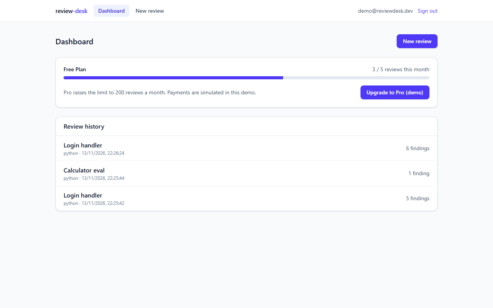
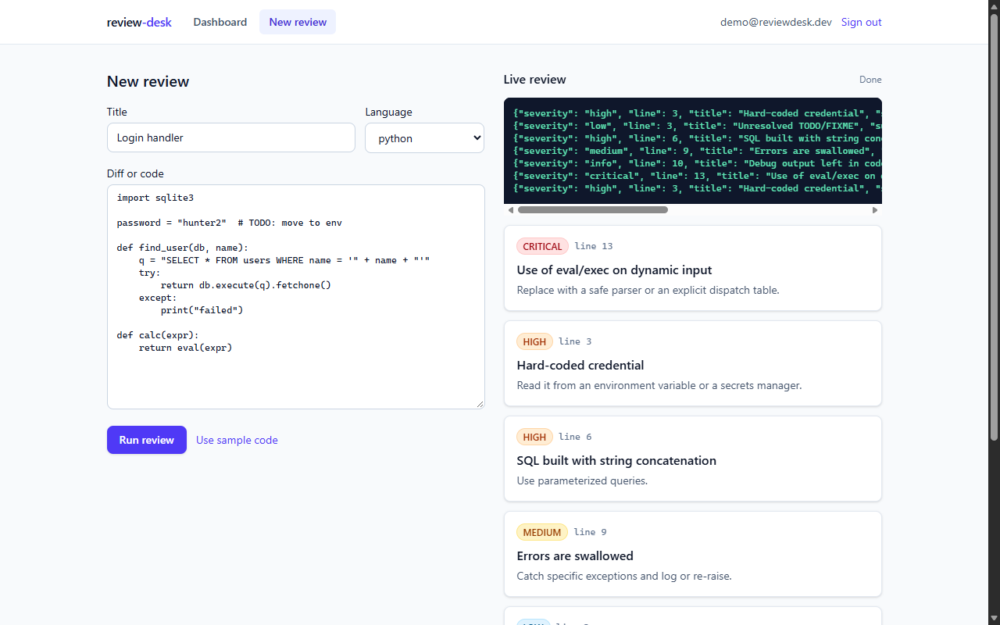
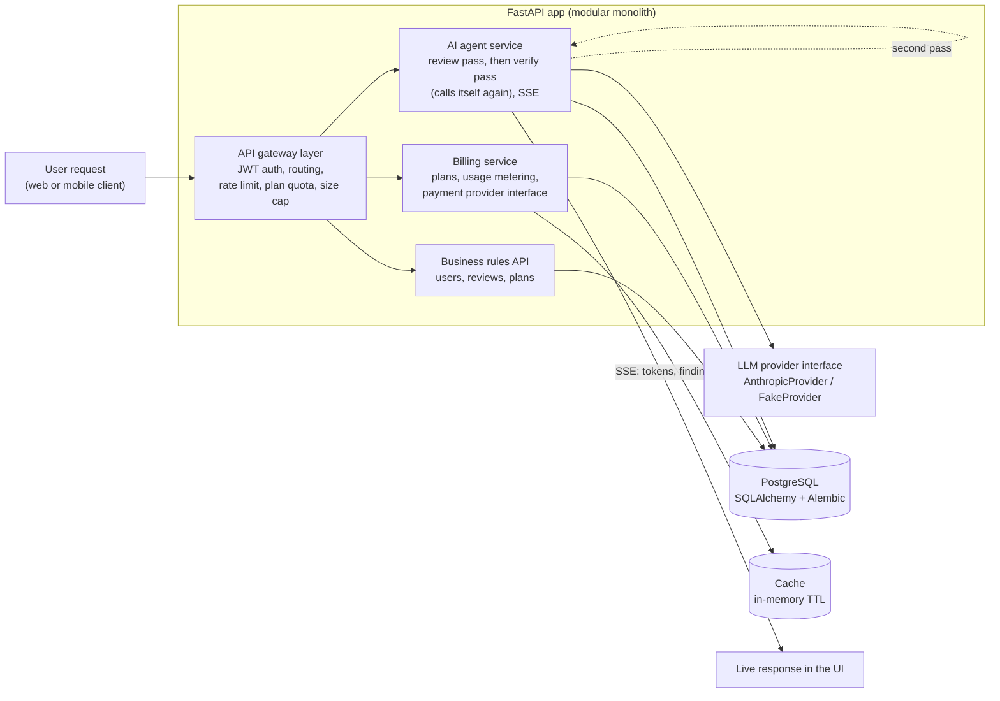

# review-desk

**Paste a diff or a snippet, get an AI code review streamed live: findings with severity, line and a suggested fix.**

`review-desk` is a small full-stack GenAI SaaS: sign-up and login, a dashboard with review history and
monthly usage against the plan limit, a "new review" page that streams the model's output as it is
produced, and a detail page for each saved review. Plans (Free / Pro) are enforced on the backend.

> **This is a portfolio project.** There are no customers and no production traffic. Payments are
> simulated (no Stripe keys, no real charges). The app runs end to end with no API key in a **demo
> mode** that uses a deterministic fake LLM provider.




## What it does

- Auth with JWT (sign-up, login, `/me`). Passwords hashed with scrypt.
- `POST /api/reviews/stream` runs the review and answers with **Server-Sent Events**: raw tokens,
  draft findings as soon as each JSON line is complete, a verification pass, then the final list.
- A two-pass **AI agent**: pass 1 drafts findings, pass 2 calls the model again with the code plus its
  own drafts to drop duplicates and unsupported findings. If pass 2 fails, the locally deduplicated
  drafts are used, so a flaky verifier never loses a review.
- Per-plan **usage limits** (Free: 5 reviews/month, Pro: 200), a per-user **rate limit**, and an
  input size cap, all enforced server-side before any LLM call.
- Review history, review detail with the flagged lines highlighted, usage meter, plan upgrade.

## Demo (no API key needed)

```bash
docker compose up --build
docker compose exec backend python -m app.seed   # optional: demo user + 2 sample reviews
```

- Web: http://localhost:5173
- API docs (Swagger): http://localhost:8000/docs
- Seeded demo login: `demo@reviewdesk.dev` / `demo-password` (demo data only), or just sign up.

Without `ANTHROPIC_API_KEY` the API uses `FakeProvider`: it streams canned findings chosen by a few
regex heuristics over your input (eval, hard-coded credentials, string-built SQL, bare `except`,
TODO, `print`). It exists so tests, CI and demos are deterministic; it is **not** a real reviewer.

To use the real model, set `ANTHROPIC_API_KEY` (see [`.env.example`](.env.example)) before
`docker compose up`. The `AnthropicProvider` was written against the official SDK's streaming
interface; I have **not** exercised it against the live API in this repo's tests (see caveats).

### Local development (without Docker)

```bash
# Backend (SQLite by default, no Postgres needed)
cd backend
python -m venv .venv && .venv/Scripts/activate      # or: source .venv/bin/activate
pip install -r requirements-dev.txt
alembic upgrade head
python -m app.seed
uvicorn app.main:create_app --factory --reload

# Frontend (proxies /api to :8000)
cd frontend
npm install
npm run dev
```

## Architecture



The "services" are separate modules with explicit boundaries inside one FastAPI process, not
separately deployed microservices. That is deliberate for a project this size; the interfaces
(`LLMProvider`, `PaymentProvider`, `Cache`) are where a split would happen.

```
backend/app/
  gateway/    deps.py (JWT user, DB session), limits.py (rate limit, quota, size)
  routers/    auth.py, reviews.py (incl. SSE), billing.py
  services/   agent.py (two-pass agent), parser.py (JSONL -> findings), billing.py, cache.py
  llm/        base.py (interface), anthropic_provider.py, fake.py, prompts.py
  models.py   User, Review, Finding, UsageEvent
backend/alembic/  migrations (PostgreSQL in compose; SQLite for dev/tests)
frontend/src/     React + TypeScript + Vite + Tailwind; pages/, components/, sse.ts, api.ts
```

## API at a glance

| Method | Path                     | Purpose                                            |
|--------|--------------------------|----------------------------------------------------|
| POST   | `/api/auth/signup`       | Create account, returns JWT                        |
| POST   | `/api/auth/login`        | Returns JWT                                        |
| GET    | `/api/auth/me`           | Current user and plan                              |
| POST   | `/api/reviews/stream`    | Run a review, answer as SSE (402 / 413 / 429 before streaming) |
| GET    | `/api/reviews`           | Your review history                                |
| GET    | `/api/reviews/{id}`      | One review with findings (404 if not yours)        |
| GET    | `/api/usage`             | Plan, period, used, limit, remaining               |
| GET    | `/api/plans`             | Available plans                                    |
| POST   | `/api/billing/checkout`  | Change plan (fake payment provider)                |

SSE events: `review` (id), `pass` (review / verify), `token`, `draft`, `final` (findings + summary), `done`, `error`.

## Design decisions

- **Limits live in the backend.** The UI shows a meter, but the 402 (monthly quota), 429 (rate
  limit, with `Retry-After`) and 413 (size) responses are produced before the stream starts and
  before any LLM call. Quota checks read the database, not the cache.
- **Metering is a ledger.** One `usage_events` row per review; usage is a count for the period.
  If the provider fails or the client disconnects before the review completes, the review is marked
  `failed` and its usage row is removed, so users are not billed for errors.
- **JSON Lines instead of free text.** The model is asked for one JSON object per line. That lets the
  parser emit each finding the moment its line completes, while tokens are still streaming. The
  parser tolerates fences, prose and split chunks, and normalizes severities.
- **Provider interface.** `LLMProvider.stream()` yields text. The fake provider keeps tests
  deterministic and free; the Anthropic provider uses the official `anthropic` SDK with streaming,
  model `claude-sonnet-5-5`, and the SDK's server-side refusal fallback.
- **Billing behind an interface.** `PaymentProvider` has a single fake implementation that activates
  the plan immediately. A Stripe implementation would create a Checkout Session and activate the plan
  from a signed webhook; nothing else would change.
- **Alembic is the schema source on PostgreSQL.** A test runs `alembic upgrade head` followed by
  `alembic check` to make sure migrations and models do not drift.

## Security notes

- Ownership is checked in the query (`Review.user_id == current_user.id`); someone else's review and a
  non-existent one both return the same 404. Covered by an IDOR test.
- JWTs are HS256-signed; forged and `alg: none` tokens are rejected (tested). Set a long random
  `JWT_SECRET`; the default exists only for local development.
- Submitted code is treated as untrusted data: the system prompts tell the model not to follow
  instructions inside it, and model output is only ever consumed through a strict parser, never
  executed or rendered as HTML.
- Auth endpoints are rate limited per IP; review streams per user.
- No secrets are committed; configuration comes from environment variables (`.env.example` only).
- The token is kept in `localStorage` for simplicity, which is exposed to XSS. An httpOnly cookie
  with CSRF protection would be the stronger choice for production.

## Tests

```bash
cd backend && pytest          # 27 tests
cd frontend && npm test       # 8 tests (vitest)
cd frontend && npm run build  # type-check + production build
cd backend && ruff check . && ruff format --check .
```

Backend tests cover auth, the 402 quota and 429 rate-limit paths (plus 413), upgrade lifting the limit,
per-user quotas, SSE streaming with `FakeProvider` (including the verify pass removing a duplicate),
provider failure not billing the user, the finding parser, forged tokens, the IDOR check, and
migration/model drift. Frontend tests cover the SSE parser and the UI components. CI
([`.github/workflows/ci.yml`](.github/workflows/ci.yml)) runs ruff, pytest, vitest and the build.

## How I built it

Built AI-augmented with Claude Code. I specified the architecture and rules, and Claude Code wrote
most of the first draft; I reviewed the code, ran it, and kept only what passes the tests. I use AI
this way on purpose, and I would rather say so than hide it. I'm Daniel Bichof, a full-stack developer
with 10 years building ERP systems for manufacturers; see also [factory-flow](https://github.com/danbws/factory-flow).

## Known limitations

- Rate limiter and cache are in memory, so they are per process. With several API replicas you would
  need Redis (the `Cache` interface is small, but a Redis implementation is **not** written).
- The quota check and the usage insert are not one atomic operation; two simultaneous requests at the
  limit could both pass. A row lock or a unique per-user counter would close that.
- The agent is a fixed two-pass pipeline, not a general tool-using agent.
- `AnthropicProvider` has not been run against the live API in this repository's tests.
- Reviews are not queued: the stream is tied to the HTTP request.

## Next steps

- Real Stripe checkout and webhook behind `PaymentProvider`.
- Redis for rate limiting and cache; atomic quota counter.
- GitHub PR integration (review a pull request by URL).
- Evaluate review quality against a labelled set of diffs.
- Refresh tokens / httpOnly cookie auth.

## License

MIT
